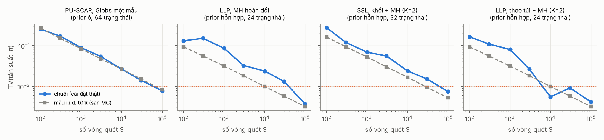
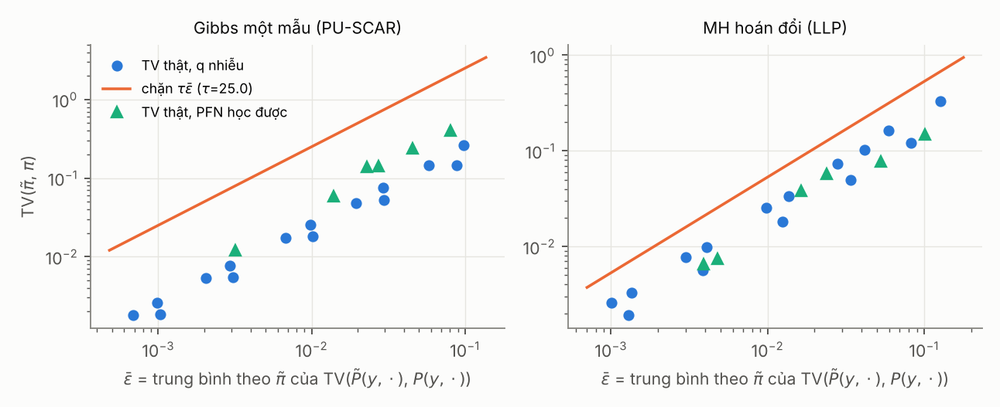
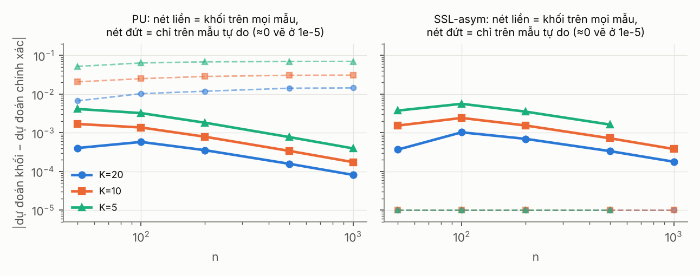

# G4 · Báo cáo kiểm chứng số RQ1 (Định lý 1, Định lý 2, Mệnh đề 4)

> Chạy trên CPU của phiên làm việc (2 lõi), 24/10/2026. Mã: `code/experiments/rq1_exact.py`, `cell_pfn.py`, `in_prior_check.py`; dữ liệu thô: `results/rq1/*.csv`; hình: `results/figures/`. Đây là kiểm chứng cho G4 (RQ1 của RESEARCH_PLAN), **không** phải thực nghiệm chính; các tiêu chí đã đăng ký ở G3 được đối chiếu nguyên văn ở §0.

## 0. Đối chiếu với dự đoán đã đăng ký (RESEARCH_PLAN §3, RQ1)

| Dự đoán đã đăng ký | Kết quả | Đạt? |
|---|---|---|
| PPD giải tích: TV < 0,01 ở 10⁵ mẫu | Ma trận chuyển chính xác: TV < 3e-14 (E1). Cài đặt thật, 4 cấu hình: TV ở 10⁵ vòng quét = 0,0078 / 0,0037 / 0,0075 / 0,0042, sát sàn Monte Carlo i.i.d. (E1mc) | **Đạt** |
| PFN học được: TV < 0,05 | PFN huấn luyện xong: 0,012 (một mẫu), 0,0066 (hoán đổi) | **Đạt** |
| PFN học được: sai lệch nằm dưới chặn của Định lý 2 | 12/12 cấu hình (E4) và 30/30 với nhiễu không tương thích (E3); chặn lỏng 2–12 lần | **Đạt** |
| Khối K = 10: TV tăng < 0,02 so với một mẫu | Chuỗi gộp một ô, n = 50–1000, khối trên mọi mẫu (D1): TV 0,005–0,012 (PU và SSL). n ≤ 14: K = 10 suy biến thành khối cỡ 1 (chính xác); khối cỡ 2 với prior hỗn hợp: TV 0,043 | **Đạt trên chuỗi gộp**; ở bài nhỏ có feature mang thông tin, khối cỡ ≥ 2 vượt ngưỡng — ghi là giới hạn |
| **Điều kiện bác bỏ:** TV không giảm theo số mẫu với PPD giải tích; hoặc TV với PFN vượt chặn | Không xảy ra | — |

## 1. E1 — Định lý 1: phân phối dừng của ma trận chuyển chính xác

Liệt kê mọi cách gán nhãn, dựng ma trận chuyển của đúng thuật toán (dùng PPD chính xác làm $q$), tính phân phối dừng và so với $\pi$ tính bằng $p(y\mid X)\ell(y)$. Hai prior: **ô–Dirichlet** (feature không mang thông tin về tham số của $y$) và **hỗn hợp 3 thành phần** (feature mang thông tin). PLL có thêm bài 3 lớp.

| prior | nhãn yếu | sơ đồ | n | số trạng thái | TV(dừng, π) | sai số cân bằng chi tiết |
|---|---|---|---:|---:|---:|---:|
| ô | PU-SCAR (c = 0,5) | một mẫu | 10 | 128 | 3,3e-15 | 2,2e-18 |
| ô | SSL | một mẫu | 10 | 128 | 4,0e-15 | 1,7e-18 |
| ô | PLL (2 lớp) | một mẫu | 10 | 128 | 4,0e-15 | 1,7e-18 |
| ô | PLL (3 lớp, \|S\| = 2) | một mẫu | 7 | 128 | 1,2e-14 | 3,3e-19 |
| ô | Nhãn nhiễu (T đã biết) | một mẫu | 8 | 256 | 1,9e-14 | 2,8e-18 |
| ô | LLP (3 túi × 4) | hoán đổi | 12 | 96 | 3,1e-15 | 8,7e-19 |
| ô | SSL | khối + MH (m = 3) | 10 | 128 | 2,8e-14 | 2,6e-18 |
| hỗn hợp | PU-SCAR (c = 0,5) | một mẫu | 10 | 128 | 3,3e-15 | 1,0e-17 |
| hỗn hợp | SSL | một mẫu | 10 | 128 | 3,0e-15 | 3,5e-17 |
| hỗn hợp | PLL (2 lớp) | một mẫu | 10 | 128 | 3,0e-15 | 3,5e-17 |
| hỗn hợp | PLL (3 lớp, \|S\| = 2) | một mẫu | 7 | 128 | 3,8e-15 | 1,1e-17 |
| hỗn hợp | Nhãn nhiễu (T đã biết) | một mẫu | 8 | 256 | 2,3e-14 | 1,4e-17 |
| hỗn hợp | LLP (3 túi × 4) | hoán đổi | 12 | 96 | 4,8e-15 | 4,8e-18 |
| hỗn hợp | SSL | khối + MH (m = 3) | 10 | 128 | 4,0e-15 | 9,4e-17 |

Mọi sai lệch ở mức sai số làm tròn số thực. Đây là kiểm chứng *tất định* của Định lý 1(a), 1(b) và Mệnh đề 4(a), mạnh hơn kiểm chứng Monte Carlo. (Với 2 lớp, PLL trùng SSL về cấu trúc nên số liệu giống nhau; bài 3 lớp mới kiểm PLL thực sự.)

## 2. E1mc — cài đặt thật của bộ lấy mẫu (Monte Carlo)

Chạy `InContextGibbs` thật (không phải ma trận chuyển) với PPD giải tích làm $q$, $10^5$ vòng quét sau 100 vòng bỏ đi, đo TV giữa tần suất trạng thái và $\pi$ chính xác. "Sàn i.i.d." là TV trung bình của $N$ mẫu độc lập lấy thẳng từ $\pi$ (không chuỗi nào làm tốt hơn mức này).

| cấu hình | prior | số trạng thái | S = 10³ | S = 10⁴ | S = 10⁵ | sàn i.i.d. ở 10⁵ |
|---|---|---:|---:|---:|---:|---:|
| PU-SCAR, Gibbs một mẫu | ô | 64 | 0,089 | 0,027 | **0,0078** | 0,0083 |
| LLP, MH hoán đổi | hỗn hợp | 24 | 0,086 | 0,024 | **0,0037** | 0,0032 |
| SSL, khối + MH (K = 2) | hỗn hợp | 32 | 0,069 | 0,024 | **0,0075** | 0,0052 |
| LLP, theo túi + MH (K = 2) | hỗn hợp | 24 | 0,081 | 0,0055 | **0,0042** | 0,0032 |

TV giảm theo bậc $S^{-1/2}$ và bám sàn i.i.d. (chuỗi chỉ tương quan vừa phải); mọi cấu hình dưới 0,01 ở $10^5$ mẫu. Kiểm chứng này bắt được lỗi cài đặt mà E1 không bắt được (E1 dựng ma trận chuyển bằng mã riêng trong `exact.py`).

## 3. E2 — Định lý 1(c): dự đoán quy nạp, chuyển nạp và Bayes chính xác

$\bar p$ là giới hạn của dự đoán Rao–Blackwell quy nạp; "Bayes chính xác" là $p(y_*\mid x_*,X,W)$ tính bằng liệt kê với $x_*$ trong chuỗi. $n = 8$.

| prior | nhãn yếu | ô của $x_*$ | $\bar p$ (quy nạp) | Bayes chính xác | chênh |
|---|---|---:|---:|---:|---:|
| ô | SSL | 0 / 1 / 2 | 0,667 / 0,500 / 0,500 | 0,667 / 0,500 / 0,500 | < 1e-15 |
| ô | PU-SCAR | 0 / 1 / 2 | 0,393 / 0,347 / 0,720 | 0,393 / 0,347 / 0,720 | < 1e-15 |
| hỗn hợp | SSL | 0 / 1 / 2 | 0,046 / 0,634 / 0,386 | 0,050 / 0,699 / 0,332 | 0,004 / **0,065** / 0,054 |
| hỗn hợp | PU-SCAR | 0 / 1 / 2 | 0,028 / 0,339 / 0,255 | 0,036 / 0,449 / 0,197 | 0,008 / **0,110** / 0,058 |

Khớp đúng phát biểu đã sửa: với prior tách được hai đại lượng trùng nhau; khi feature mang thông tin thì khác, và chế độ chuyển nạp khớp Bayes chính xác (kiểm thử `test_rao_blackwell_and_transductive`, sai số Monte Carlo < 0,02). Chênh lệch ở đây lớn vì $n = 8$ (một điểm $x_*$ có ảnh hưởng lớn lên posterior); với $n$ lớn kỳ vọng nhỏ hơn — **chưa đo**, đưa vào G6.

## 4. E3, E4 — Định lý 2: TFM xấp xỉ, kể cả không tương thích

Bài: PU-SCAR ($n = 10$, 8 mẫu tự do, 256 trạng thái) với Gibbs một mẫu quét ngẫu nhiên, và LLP (3 túi × 4, 96 trạng thái) với MH hoán đổi; prior ô. $\tau(P)=\sum_t\delta(P^t)$ tính từ ma trận chuyển chính xác: **25,0** (một mẫu), **5,3** (hoán đổi).

**E3 — $q$ = PPD nhân nhiễu giả ngẫu nhiên** (phụ thuộc cả số đếm toàn cục ⇒ không tương thích, đã kiểm bằng hai đường Brook). Trung bình 3 seed:

| sơ đồ | δ | ε_TV | ε̄ (lỗi nhân) | TV(π̃, π) thật | chặn τ·ε̄ | chặn Mitrophanov | chặn theo ε (2κε hoặc 4ε∞) | lỏng (τε̄ / thật) |
|---|---:|---:|---:|---:|---:|---:|---:|---:|
| một mẫu | 0,01 | 0,004 | 0,0009 | 0,0021 | 0,023 | 0,065 | 0,37 | 11× |
| một mẫu | 0,1 | 0,042 | 0,0089 | 0,020 | 0,22 | 0,64 | 3,7 | 11× |
| một mẫu | 1,0 | 0,342 | 0,081 | 0,183 | 2,03 | 6,17 | 30 | 12× |
| hoán đổi | 0,01 | 0,004 | 0,0012 | 0,0026 | 0,0065 | 0,020 | 0,17 | 2,6× |
| hoán đổi | 0,1 | 0,035 | 0,012 | 0,026 | 0,064 | 0,19 | 1,7 | 2,6× |
| hoán đổi | 1,0 | 0,305 | 0,090 | 0,206 | 0,48 | 1,08 | 21 | 2,5× |

- Chặn $\tau\bar\varepsilon$ đúng ở **30/30** cấu hình; chặt hơn chặn Mitrophanov khoảng 3 lần; dạng theo $\varepsilon$ của TFM lỏng thêm 10–40 lần.
- Hệ quả (iv) cho dự đoán đúng ở 30/30 cấu hình. Các bất đẳng thức trung gian (ii), (iii) đúng ở mọi trạng thái.
- TV thật tăng tuyến tính theo sai số (bậc đúng như chặn dưới của Liu et al. 2014).

**E4 — $q$ = PFN nhỏ huấn luyện trên đúng prior ô** (`cell_pfn.py`; các ảnh chụp ở các bước huấn luyện khác nhau cho các mức sai số khác nhau):

| ảnh chụp PFN | sơ đồ | ε_TV | ε∞ | ε̄ | TV(π̃, π) thật | chặn τ·ε̄ | chặn Mitrophanov | lỏng |
|---|---|---:|---:|---:|---:|---:|---:|---:|
| bước 50 | một mẫu | 0,358 | 1,21 | 0,081 | 0,401 | 2,01 | 10,7 | 5,0× |
| bước 400 | một mẫu | 0,050 | 0,21 | 0,014 | 0,059 | 0,35 | 1,17 | 5,9× |
| bước 2500 | một mẫu | 0,072 | 0,31 | 0,027 | 0,144 | 0,68 | 1,90 | 4,7× |
| **cuối (6000)** | một mẫu | 0,021 | 0,11 | 0,0032 | **0,012** | 0,080 | 0,46 | 6,7× |
| bước 50 | hoán đổi | 0,305 | 0,93 | 0,101 | 0,148 | 0,54 | 1,53 | 3,6× |
| bước 400 | hoán đổi | 0,033 | 0,15 | 0,0048 | 0,0075 | 0,026 | 0,074 | 3,4× |
| bước 2500 | hoán đổi | 0,068 | 0,28 | 0,024 | 0,058 | 0,13 | 0,46 | 2,2× |
| **cuối (6000)** | hoán đổi | 0,012 | 0,064 | 0,0039 | **0,0066** | 0,021 | 0,063 | 3,1× |

- Chặn đúng ở **12/12** cấu hình (6 ảnh chụp × 2 sơ đồ); hệ quả dự đoán (iv) đúng ở 12/12.
- PFN huấn luyện xong: TV = 0,012 (Gibbs một mẫu) và 0,0066 (hoán đổi), **dưới ngưỡng 0,05 đã đăng ký**.
- Sai số không giảm đơn điệu theo bước huấn luyện (bước 400 tốt hơn bước 2500) do lịch learning rate một chu kỳ; không ảnh hưởng tới kết luận vì mỗi ảnh chụp được đánh giá độc lập.
- Một PFN học được cho các xác suất có điều kiện không tương thích một cách tự nhiên; Định lý 2 vẫn áp dụng (Bước 0 không cần tương thích).

## 5. E5 — Mệnh đề 4: cập nhật theo khối

**E5a — bài nhỏ chính xác** (SSL, $n = 10$, 2 mẫu có nhãn, 8 tự do; khối là mọi tập con cỡ $m$ của mẫu tự do):

| prior | m (K) | TV xấp xỉ | sai số dự đoán xấp xỉ | TV có sửa MH |
|---|---|---:|---:|---:|
| ô | 1 (8) | 0 | 0 | — |
| ô | 2 (4) | 0,019 | < 1e-14 | < 1e-14 |
| ô | 4 (2) | 0,069 | < 1e-14 | < 1e-13 |
| ô | 8 (1) | 0,356 | < 1e-14 | < 1e-14 |
| hỗn hợp | 2 (4) | 0,081 | 0,049 | < 1e-14 |
| hỗn hợp | 4 (2) | 0,337 | 0,210 | < 1e-13 |
| hỗn hợp | 8 (1) | 0,701 | 0,451 | < 1e-14 |

Với prior ô, khối chỉ làm sai *độ phân tán* của posterior, không làm sai *trung bình dự đoán*; với prior hỗn hợp (thêm nguồn sai (ii): bỏ feature trong khối khỏi điều kiện hoá), sai cả dự đoán, và rất lớn ở $n = 10$. Bản sửa MH chính xác trong mọi trường hợp.

**E5a2 — cùng bài, khối là tập con cỡ $m$ của MỌI mẫu** (mẫu có nhãn trong khối bị bỏ khỏi ngữ cảnh nhưng không bị lấy mẫu lại; D1):

| prior | m | TV: chỉ mẫu tự do → mọi mẫu | sai số dự đoán: chỉ mẫu tự do → mọi mẫu |
|---|---:|---|---|
| ô | 2 | 0,019 → 0,015 | ~0 → ~0 |
| ô | 4 | 0,069 → 0,050 | ~0 → ~0 |
| ô | 8 | 0,356 → 0,187 | ~0 → ~0 |
| hỗn hợp | 2 | 0,081 → 0,043 | 0,049 → **0,011** |
| hỗn hợp | 4 | 0,337 → 0,154 | 0,210 → 0,061 |
| hỗn hợp | 8 | 0,701 → 0,317 | 0,451 → 0,111 |

Chia trên mọi mẫu giảm sai số dự đoán khoảng 4 lần ở bài nhỏ có feature mang thông tin. Phần còn lại vẫn lớn ở $n=10$ vì mỗi điểm bị bỏ khỏi ngữ cảnh chiếm 10–80% dữ liệu.

**E5b — chuỗi gộp một ô, $n$ tới 2000** (tính chính xác nhờ trao đổi được: trạng thái là số dương trong các mẫu tự do). SSL: 10% có nhãn, nửa dương. PU: $\pi_p=0{,}4$, $c=0{,}3$. Khối **chỉ trên mẫu tự do**.

TV(π_khối, π):

| bối cảnh | n | m = 2 | m = 10 | K = 20 | K = 10 | K = 5 |
|---|---:|---:|---:|---:|---:|---:|
| SSL | 100 | 0,0013 | 0,0116 | 0,0038 | 0,0102 | 0,0224 |
| SSL | 500 | 0,0002 | 0,0022 | 0,0052 | 0,0110 | 0,0230 |
| SSL | 2000 | 0,0001 | 0,0005 | 0,0055 | 0,0112 | 0,0231 |
| PU | 100 | 0,0135 | 0,128 | 0,041 | 0,098 | 0,238 |
| PU | 500 | 0,0059 | 0,054 | 0,127 | 0,266 | 0,540 |
| PU | 2000 | 0,0029 | 0,027 | 0,260 | 0,510 | 0,864 |

Sai số dự đoán ở PU (chia trên mẫu tự do): K = 10 ⇒ 0,025 (n = 100), 0,031 (n = 500), 0,031 (n = 2000) — **không giảm theo n**.

Đọc bảng: với kích thước khối cố định ($m$), sai số giảm như $O(m/n)$; với số khối cố định ($K$, cách dùng trong thực tế), TV không giảm theo $n$. Ở PU, sai số lớn hơn SSL nhiều lần và có **lệch dự đoán** hệ thống. Nguyên nhân: khi chỉ chia mẫu tự do, ngữ cảnh $D_{-B}$ giữ mọi dương có nhãn nhưng bỏ bớt mẫu không nhãn, nên tỉ lệ dương trong ngữ cảnh bị đẩy lên (lệch thành phần).

**E5c — sửa bằng cách chia khối trên mọi mẫu** (quyết định D1 của METHOD_SPEC):

Cùng chuỗi gộp, so hai cách chia khối với cùng số khối K. PU như trên; SSL-asym: 10% có nhãn, 30% trong số đó dương. (Ô n = 1000, K = 5 của SSL-asym bị bỏ vì chạy quá lâu trên CPU.)

Sai số dự đoán |dự đoán khối − dự đoán chính xác|:

| bối cảnh | n | K = 20: chỉ mẫu tự do → mọi mẫu | K = 10: chỉ mẫu tự do → mọi mẫu | K = 5: chỉ mẫu tự do → mọi mẫu |
|---|---:|---|---|---|
| PU | 50 | 0,0067 → 0,0004 | 0,021 → 0,0017 | 0,052 → 0,0041 |
| PU | 200 | 0,012 → 0,00035 | 0,029 → 0,00079 | 0,068 → 0,0018 |
| PU | 1000 | 0,014 → 0,00008 | **0,031 → 0,00017** | 0,070 → 0,00039 |
| SSL-asym | 50 | ~0 → 0,0004 | ~0 → 0,0015 | ~0 → 0,0037 |
| SSL-asym | 200 | ~0 → 0,0007 | ~0 → 0,0015 | ~0 → 0,0035 |
| SSL-asym | 1000 | ~0 → 0,0002 | ~0 → 0,0004 | — |

TV(π_khối, π) khi chia trên mọi mẫu: PU 0,0049 / 0,0104 / 0,0232 và SSL-asym 0,0055 / 0,0115 / 0,0248 (n = 1000 hoặc 500; K = 20 / 10 / 5), gần như không đổi theo n và xấp xỉ $0{,}1/K$.

Kết luận:
1. Chia trên mọi mẫu loại bỏ lệch thành phần: lệch dự đoán ở PU giảm 30–180 lần và **giảm theo $O(1/n)$**; khi chia chỉ trên mẫu tự do, lệch không giảm theo $n$.
2. Cái giá: ở SSL có tỉ lệ nhãn cân với posterior (không có lệch thành phần), chia trên mọi mẫu thêm một sai số nhỏ $O(1/n)$ (0,0004 ở n = 1000, K = 10). Chấp nhận được; vì vậy D1 chọn chia trên mọi mẫu.
3. Phần TV còn lại (≈ 0,1/K, không giảm theo n) là sai về **độ phân tán** của posterior của nhãn (khối bỏ qua phụ thuộc trong khối), không phải về trung bình dự đoán. Muốn chính xác: dùng bản sửa MH.

## 6. E6 — kiểm tra trong prior với một PFN thật (mini-TabPFN của khóa học)

Mini-TabPFN của khóa học (4 lớp, huấn luyện trên prior SCM, ngữ cảnh ≤ 100 hàng) làm $q$; 40 dataset sinh từ **chính prior đó** (nhị phân, lớp thiểu số ≥ 15%), $n_{train}=80$, $n_{test}=200$. PU-SCAR $c=0{,}3$ đã biết; LLP túi cỡ 8. Gibbs khối: K = 10, 30 vòng, bỏ 10, 10 mẫu Rao–Blackwell. Vì dữ liệu nằm trong prior và $q\approx$ PPD, Mệnh đề 3 dự đoán Gibbs có **log loss** thấp nhất trung bình theo prior.

Log loss trung bình (thấp hơn là tốt hơn); oracle (nhãn sạch) = 0,546:

| | naive | hard-EM | SEM (mẫu cuối) | Gibbs khối | Gibbs chính xác (một mẫu / hoán đổi) |
|---|---:|---:|---:|---:|---:|
| PU-SCAR | 0,669 | 0,729 | 0,649 | **0,609** | 0,616 |
| LLP | 0,618 | 0,665 | 0,591 | **0,585** | 0,594 |

Chênh lệch ghép cặp theo dataset (Gibbs khối − đối thủ), khoảng tin cậy bootstrap 95%:

| | − naive | − hard-EM | − SEM | Gibbs chính xác − Gibbs khối |
|---|---|---|---|---|
| PU log loss | −0,060 [−0,113; −0,017] | −0,120 [−0,155; −0,085] | −0,040 [−0,061; −0,021] | +0,007 [−0,006; +0,020] |
| LLP log loss | −0,033 [−0,069; −0,004] | −0,080 [−0,116; −0,042] | −0,006 [−0,017; +0,005] | +0,009 [−0,004; +0,031] |
| PU AUC | +0,007 [−0,005; +0,018] | +0,007 [−0,005; +0,018] | +0,042 [+0,019; +0,066] | +0,001 [−0,015; +0,016] |
| LLP AUC | +0,043 [−0,013; +0,107] | +0,012 [−0,019; +0,048] | +0,015 [−0,014; +0,044] | +0,007 [−0,012; +0,028] |

Đọc kết quả:
- Đúng hướng lý thuyết dự đoán: Gibbs tốt hơn naive và hard-EM về log loss ở cả PU và LLP; với PU còn tốt hơn SEM (lợi ích của việc lấy trung bình Bayes).
- **PU-SCAR, AUC: Gibbs ≈ naive** (+0,007, không có ý nghĩa) — đúng như lập luận Elkan–Noto (GATE_REVIEW_G4 #2). Đây là bằng chứng thực nghiệm đầu tiên cho rủi ro đó.
- Gibbs khối không kém bản chính xác một cách đo được (bản chính xác ở đây chạy ít vòng hơn: 15 vòng).
- Giới hạn: PFN nhỏ, $n$ nhỏ, dữ liệu trong prior. Không nói gì về TabPFN trên dữ liệu thật.

## 7. Giới hạn của các kiểm chứng này
- Bài toán chính xác nhỏ ($n\le12$); chuỗi gộp chỉ có một ô (không có nguồn sai (ii)). Hành vi ở $n$ lớn với feature mang thông tin chưa đo chính xác được; E6 và thí điểm GPU là bằng chứng gián tiếp.
- $\tau(P)$ chỉ tính được khi biết ma trận chuyển chính xác; trong thực tế Định lý 2 là công cụ giải thích, không phải chứng chỉ tính được.
- PFN ở E4 là mô hình nhỏ trên prior đơn giản; sai số của TabPFN thật trên dữ liệu thật không đo được trực tiếp.
