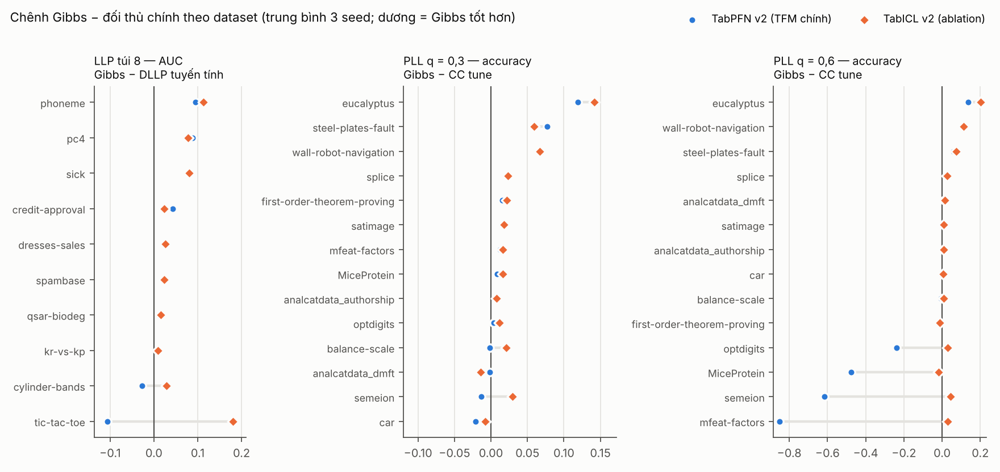
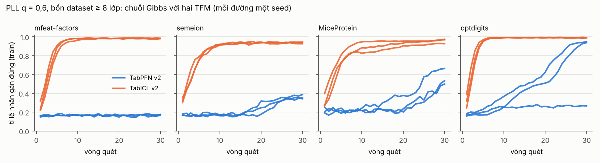
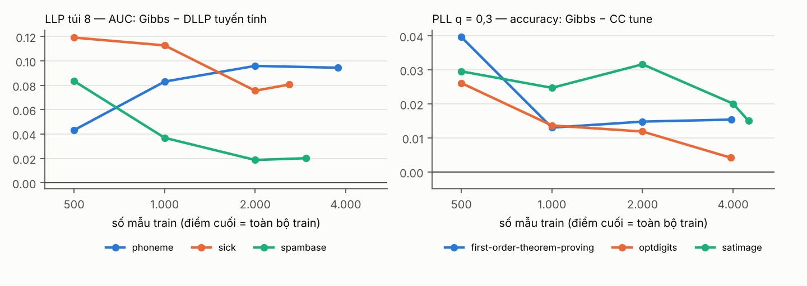

# G8 — phân tích kết quả tập đánh giá (30/10/2026)

Báo cáo này thay [G8_PRELIM_REPORT](G8_PRELIM_REPORT.md). Mục 3.2 của bản sơ bộ (phân tích lỗi) vẫn đúng, ở đây chỉ cập nhật số.

## Trạng thái dữ liệu

| Phần | Số ô | Ghi chú |
|---|---|---|
| Phần chính (TFM) | **2.190 / 2.190** | L3 lần 2 bù đủ 25 ô thiếu. 179 ô có ở cả hai lần chạy L3 cho kết quả **giống hệt từng bit** |
| Baseline | 3.492 / 3.492 | |
| R̂ | 117 / 117 | |
| RQ5 (PLL thật) | TFM 150 / 150; baseline 240 / 240 | |
| Ablation K, số vòng quét, sửa MH, chuyển nạp | 36, 36, 18, 30 | đủ |
| Ablation prior η, TabICL | 120, 570 | đủ |
| Ablation cỡ dữ liệu | TFM 285; đối thủ chính 57 | đủ |
| **Ablation khởi tạo lạnh** | **93 / 114** | thiếu 21 ô: OpenML lỗi 503 khi chạy L5. Cần chạy lại L5 |

- **Mã băm:**
  - Dữ liệu và lần chia khớp `docs/dataset_hashes.csv` ở cả 1.509 dòng mới.
  - Code của L3 lần 2, L4, L5, L6 khớp kho (64/64 tệp).
  - SHA-256 tệp PLL thật khớp với lượt C3.
- **Script:** chạy lại mọi bảng và hình bằng bốn lệnh trong `G8/analysis/`.
  - `g8_confirmatory.py`: kiểm định xác nhận.
  - `g8_descriptive.py`: R̂, H5, ablation, cỡ dữ liệu, TabICL.
  - `g8_pll_collapse.py`: phân tích lỗi.
  - `g8_figures.py`: hình.
- **Kết quả và hình:** `G8/results/`, `G8/figures/`.
- **Quy tắc khi một ô có ở hai lần chạy:** giữ kết quả hợp lệ đầu tiên, đúng nghĩa "chạy tiếp" của bộ chạy. Quy tắc này em đặt trước khi so số. Vì hai lần chạy giống hệt nhau nên chọn lần nào cũng không đổi kết quả.

## 1. Kết luận chính

1. **Kiểm định xác nhận.** TFM chính là TabPFN v2, như đã đăng ký. Kết quả:
   - H2-LLP túi 8: **không đạt**.
   - H4-PLL: **không đạt**.
   - H3: **đạt**.
   - H5: **đạt** theo đơn vị đã đăng ký (nguồn PLL thật: Gibbs xếp thứ 1). Nếu tính từng dataset thì không đạt (Lost: thứ 3).
2. **Tiêu chí thành công đã ghi trước.** Mức tối thiểu không đạt, vì cả H2-LLP lẫn H4-PLL đều không đạt. Do đó điều kiện chuyển sang phương án B đã thoả.
3. **Phát hiện quan trọng nhất (ablation TFM, đọc như kết quả thăm dò).** Thay TabPFN v2 bằng TabICL v2 cho mọi phương pháp dựa trên TFM, rồi áp đúng các kiểm định của H2 và H4:
   - Mọi kiểm định đều đạt, kể cả phân tích độ nhạy S1.
   - Gibbs thắng DLLP tuyến tính ở **10/10** dataset LLP, và thắng CC tune ở **12/14** dataset PLL ở cả hai mức q.
   - TabICL v2 đã được đăng ký là ablation, không phải TFM chính. Chọn TFM sau khi xem kết quả là một lối rẽ phân tích. Vì vậy kết quả này **không phải bằng chứng xác nhận** (Mục 7).
4. **Gibbs với TabPFN sụp ở PLL q = 0,6 trên dataset ≥ 8 lớp** (mfeat-factors, semeion, MiceProtein, optdigits). Lỗi này gắn với TFM: chuỗi Gibbs với TabPFN kẹt ở trạng thái không thông tin, còn chuỗi với TabICL thoát ra sau vài vòng quét (Hình 2).
5. **Các thành phần khác của phương pháp ít quan trọng.**
   - Số khối K, số vòng quét, sửa MH và prior η thay đổi kết quả không quá ±0,015.
   - Chuyển nạp (bản Bayes chính xác) kém quy nạp: −0,013 AUC, 23/30 ô thua.
   - Khởi động ấm hơi tốt hơn khởi động lạnh ở LLP.

## 2. Kiểm định xác nhận (TabPFN v2), kèm kết quả cùng kiểm định với TabICL v2 (thăm dò)

| | **TabPFN v2 — xác nhận** | TabICL v2 — thăm dò |
|---|---|---|
| **H2-LLP túi 8**, Gibbs − DLLP tuyến tính (AUC) | +0,024 [−0,013; +0,057], 8/2, **Holm 0,23** | +0,058 [+0,029; +0,093], 10/0, Holm 0,004 |
| Gibbs − TFM ngây thơ | +0,148, 10/0, Holm 0,004 | +0,176, 10/0, Holm 0,004 |
| Thắng trước baseline mạnh nhất (LLP-VAT tune), cần ≥ 7/10 | **6/10** | 9/10 |
| → H2-LLP | **không đạt** | đạt *(nếu là kiểm định xác nhận)* |
| **H4-PLL q = 0,3**, Gibbs − CC tune (accuracy) | +0,022 [+0,005; +0,044], 10/4, **Holm 0,084** | +0,030 [+0,013; +0,051], 12/2, Holm 0,004 |
| **H4-PLL q = 0,6**, Gibbs − CC tune | **−0,132** [−0,301; +0,002], 7/7, **Holm 0,71** | +0,038 [+0,013; +0,071], 12/2, Holm 0,009 |
| Gibbs − TFM ngây thơ (q = 0,3 / 0,6) | +0,099 / +0,180, Holm ≤ 0,002 | +0,063 / +0,262, Holm ≤ 0,005 |
| Quy tắc 60%, mọi cách đọc (gộp hai mức) | 57–61%; q = 0,6 chỉ 6–7/14 | 82–86%; q = 0,6 đạt 11–12/14 |
| S1 (bỏ 4 dataset), Gibbs − CC tune | Holm 0,055 / 0,77 | Holm 0,029 / 0,029 |
| → H4-PLL | **không đạt** | đạt *(nếu là kiểm định xác nhận)* |

- Cột "thăm dò" dùng **đúng code, đúng kiểm định, đúng đối thủ**; chỉ đổi TFM.
- Nếu coi việc chọn một trong hai TFM là bài toán so sánh bội và nhân p (sau Holm) lên 2 lần (Bonferroni):
  - Trên 14 dataset, mọi kiểm định của TabICL vẫn dưới 0,05 (lớn nhất 0,017).
  - Ở S1, kiểm định với CC tune vượt ngưỡng (0,059).
  - Đây chỉ là phân tích độ nhạy, không biến kết quả thăm dò thành kết quả xác nhận.
- Kết quả TFM chính, theo dataset: Hình 1 (chấm xanh), các bảng `table_llp8.csv`, `table_pll_*.csv`.
- **Chi tiết H2 và H4 của TabPFN như bản sơ bộ** (Mục 2, 3.1 của [G8_PRELIM_REPORT](G8_PRELIM_REPORT.md)), cập nhật hai điểm:
  - H4 ở q = 0,6 nay đủ 3 seed: −0,132, p = 0,71.
  - D1 nay có p = 0,039.

**Hình 1.** Chênh Gibbs − đối thủ chính theo dataset. Chấm xanh là TabPFN v2 (TFM chính), hình thoi cam là TabICL v2. Các điểm âm lớn của TabPFN ở PLL q = 0,6 chính là bốn dataset ≥ 8 lớp.

**Đọc ở dataset nào thì TFM quyết định kết quả.**
- **PLL:** toàn bộ khác biệt ở q = 0,6 nằm ở bốn dataset ≥ 8 lớp. Ở các dataset ≤ 7 lớp, hai TFM gần như trùng nhau.
- **LLP:** TabICL hơn TabPFN rõ nhất ở tic-tac-toe (+0,29 AUC; nhãn sinh từ quy tắc logic) và cylinder-bands. Ở dataset còn lại hai TFM gần nhau.
- **Tập phát triển:** ở G6 lượt 7, TabICL không tốt hơn rõ (LLP: Gibbs 0,815 so với DLLP tuyến tính 0,811), và tập phát triển không có dataset ≥ 8 lớp. Vì vậy trước G7 không có cơ sở để đổi TFM chính, và việc chọn TabICL bây giờ là chọn sau khi xem kết quả.

## 3. H3 — Gibbs so với hard-EM (log loss, TabPFN v2): **đạt**

| Bối cảnh | số ô | Gibbs tốt hơn | Spearman (mức yếu, chênh) |
|---|---|---|---|
| LLP túi 8, 16 | 20 | 95% | 0,31 |
| PLL q 0,3, 0,6 | 28 | 82% | 0,64 |
| PU-SAR (Gibbs biết propensity) | 20 | 85% | 0,07 |
| PU-SCAR (log loss khớp tiên nghiệm) | 20 | 75% | 0,28 |
| SSL | 20 | 100% | 0,38 |
| Nhãn nhiễu | 20 | 85% | 0,54 |
| **Tất cả** | **128** | **86,7%** | **0,36** (p = 3·10⁻⁵) |

Bayesian signed-rank (ROPE ±0,005) cho P(Gibbs tốt hơn) = 1,00 và P(ROPE) = 0,00. H3 đạt cả ba điều kiện đã đăng ký.

## 4. H5 — PLL thật (TFM: TabICL v2, như đã đăng ký từ F6)

| accuracy, trung bình 10 lần chia | BirdSong | Lost | MSRCv2 |
|---|---|---|---|
| **Gibbs ấm** | **0,759** | **0,750** | **0,628** |
| baseline tốt nhất | 0,731 (GLWS/ILL tune) | 0,748 (PRODEN tune) | 0,582 (GLWS/ILL mặc định) |
| TFM ngây thơ | 0,689 | 0,481 | 0,491 |
| hard-EM / SEM | 0,730 / 0,744 | 0,665 / 0,716 | 0,627 / 0,622 |
| oracle | 0,835 | 0,889 | 0,824 |
| Gibbs − baseline tốt nhất (thắng/thua qua 10 lần chia) | +0,028 (8/2) | +0,002 (5/5) | +0,045 (8/2) |
| **Hạng trung bình của Gibbs** trong 10 phương pháp (Gibbs, ngây thơ, 8 baseline) | **1,20 (thứ 1)** | 4,05 (thứ 3) | **1,20 (thứ 1)** |

- **Gộp cả nguồn PLL thật:** hạng trung bình 2,15, thứ 1/10. Đơn vị của H5 đã đăng ký là "nguồn", nên H5 **đạt**.
- **Tính từng dataset:** không đạt ở Lost (thứ 3). Ở Lost bốn phương pháp đầu chỉ cách nhau dưới 0,003 accuracy.
- LLP-Bench bị bỏ theo quy tắc ghi trước, vì không có dữ liệu Criteo khi xong L6 (giao thức §11).
- Đáng chú ý: PLL thật có tập ứng viên nhỏ (trung bình 2,2–3,2 nhãn). Đây đúng là vùng PLL mà Gibbs làm tốt.

## 5. Phân tích lỗi: PLL q = 0,6, dataset ≥ 8 lớp (thăm dò)

**Với TabPFN v2: 10 ô sụp.**
- Định nghĩa "sụp": Gibbs kém CC tune từ 0,2 trở lên.
- 10 ô này nằm đúng trên bốn dataset ≥ 8 lớp: MiceProtein, mfeat-factors, semeion (3/3 seed), optdigits (1/3 seed).
- Cơ chế: điểm khởi động gần như ngẫu nhiên, và chuỗi kẹt ở trạng thái tự duy trì: nhãn ngẫu nhiên làm TFM dự đoán đều, dự đoán đều lại sinh nhãn ngẫu nhiên. Chi tiết ở bản sơ bộ, Mục 3.2.

**Với TabICL v2: không ô nào sụp.**
- Cả 12 chuỗi ở bốn dataset này đạt 0,93–0,99 nhãn gán đúng ở vòng quét cuối.
- TabICL bắt đầu từ cùng loại điểm khởi động yếu: sau vòng quét đầu chỉ 22–40% nhãn đúng. Nhưng chuỗi leo lên quanh 0,9 trong khoảng 5–15 vòng (Hình 2).
- TabICL ngây thơ cũng tốt hơn TabPFN ngây thơ trên bốn dataset này (0,31–0,56 so với 0,11–0,21).
- Em đọc đây là khác biệt về độ bền của TFM khi nhãn trong ngữ cảnh rất nhiễu và có nhiều lớp. Tín hiệu yếu ("nhãn thật luôn có trong tập ứng viên") đủ để TabICL khuếch đại, nhưng không đủ với TabPFN v2 ở cỡ 756–1.395 mẫu.

**Khởi động lạnh (TabPFN) không chữa được.**
- mfeat-factors vẫn 0,10 ở cả 3 seed.
- optdigits đổi lưu vực theo seed: seed 1 từ 0,29 lên 0,98, nhưng seed 2 từ 0,92 xuống 0,67.
- Dữ liệu khởi động lạnh của semeion và MiceProtein thiếu do lỗi 503.

**Hình 2.** Tỉ lệ nhãn gán đúng trên train theo vòng quét (chỉ để chẩn đoán, phương pháp không dùng nhãn thật). TabPFN v2 màu xanh, TabICL v2 màu cam, mỗi đường một seed.

## 6. Chẩn đoán chuỗi và ablation (mô tả)

### 6.1 R̂: hai chuỗi, 3 dataset nhỏ mỗi nhóm, mọi bối cảnh × mức
| | tỉ lệ mẫu có R̂ > 1,1 (trung vị) | chênh metric test giữa 2 chuỗi (trung vị / lớn nhất) |
|---|---|---|
| LLP túi 8 / 16 / 32 | 11% / 21% / 11% | 0,041 / 0,031 / 0,023 (lớn nhất 0,12) |
| PLL q 0,3 / 0,6 | 6% / 21% | 0,006 / 0,016 (lớn nhất 0,05) |
| PU-SAR c 0,1 / 0,3 | 5% / 29% | 0,020 / 0,013 |
| PU-SCAR c 0,1 / 0,3 | 7% / 19% | 0,016 / 0,027 (lớn nhất 0,18) |
| SSL 5% / 20% | 27% / 12% | 0,021 / 0,008 (lớn nhất 0,14) |
| Nhãn nhiễu r 0,2 / 0,4 | 6% / 28% | 0,007 / 0,027 (lớn nhất 0,18) |

- **Chuỗi chưa trộn hết ở mức nhãn từng mẫu.** Theo hiệu chỉnh ở G6, khi trộn hoàn hảo thì tỉ lệ này ≤ 4,5%. Ở đây trung vị 5–29%, thường cao hơn ở mức yếu hơn.
- **Chênh dự đoán giữa hai chuỗi thường nhỏ** (trung vị 0,006–0,041), nhưng có ô tới 0,18.
- Bài phải nói rõ: 30 vòng quét cho dự đoán ổn định trong phần lớn ô, chứ không cho mẫu từ posterior đã hội tụ.

### 6.2 Các thành phần của phương pháp
Mỗi biến thể so với `gibbs_warm` trên cùng ô; chênh dương nghĩa là biến thể tốt hơn.

| Ablation | LLP túi 8 (AUC), thắng/thua | PLL (accuracy), thắng/hoà/thua | Ghi chú |
|---|---|---|---|
| K = 5 / K = 20 (mặc định 10) | −0,005 (6/3) / +0,008 (5/4) | +0,004 / +0,006 | 3 dataset nhỏ, 9 ô mỗi bối cảnh |
| 15 / 60 vòng quét (mặc định 30) | +0,005 (4/5) / +0,014 (4/5) | +0,004 / +0,005 (4/5/0) | 60 vòng nhỉnh hơn nhất quán ở PLL (4 thắng, 0 thua) |
| Khối có sửa MH (chính xác) | +0,010 (4/5) | +0,006 (4/3/2) | không khác biệt có hệ thống, khớp G6 |
| Chuyển nạp (Bayes chính xác, Định lý 1c) | **−0,013 (7/23)**; log loss kém 0,042 | — | bản chính xác kém bản quy nạp |
| Khởi động lạnh | −0,005 (10/20) | q 0,3: 0,000 (9/18/7); q 0,6: +0,012 (10/5/14) | thiếu 21 ô PLL (OpenML) |
| Prior η: N(0,1) / N(0,4²), mặc định N(0,2²) | PU-SAR: −0,002 tới +0,001 / −0,004 tới −0,001 AUC | — | không nhạy với prior |

### 6.3 Cỡ dữ liệu (Hình 3)
- Gibbs hơn đối thủ chính ở **mọi cỡ** trên cả 6 dataset: LLP +0,02 tới +0,12 AUC; PLL +0,004 tới +0,04.
- Ở 5/6 dataset, khoảng cách thu hẹp khi n tăng: sick, spambase, optdigits, first-order, satimage. Điều này khớp dự đoán độ lớn ở G3: "mức hơn giảm khi n tăng".
- Ngược lại, phoneme tăng từ +0,04 lên +0,09.

### 6.4 TFM: TabICL v2 so với TabPFN v2
| | LLP túi 8 (AUC) | PLL q 0,3 | PLL q 0,6 |
|---|---|---|---|
| Gibbs: TabICL / TabPFN | 0,889 / 0,855 | 0,854 / 0,847 | **0,831 / 0,661** |
| TFM ngây thơ: TabICL / TabPFN | 0,713 / 0,707 | 0,791 / 0,748 | 0,569 / 0,481 |
| Oracle: TabICL / TabPFN | 0,928 / 0,923 | 0,865 / 0,863 | 0,865 / 0,863 |

- Với nhãn sạch, hai TFM ngang nhau (oracle chênh ≤ 0,005).
- Khác biệt chỉ xuất hiện khi nhãn trong ngữ cảnh yếu hoặc nhiễu. Vậy chất lượng của In-Context Gibbs phụ thuộc vào **độ bền của TFM với nhãn ngữ cảnh nhiễu**, một tính chất mà accuracy trên nhãn sạch không cho thấy.

## 7. Bối cảnh phụ và thăm dò D1–D3
Như bản sơ bộ, Mục 5 (số không đổi; D1 nay p = 0,039).
- **LLP túi 16, 32:** hơn DLLP tuyến tính nhưng không có ý nghĩa; hơn hẳn TFM ngây thơ.
- **PU-SAR:** hơn nnPU nhưng không có ý nghĩa; ngang TFM ngây thơ.
- **PU-SCAR, SSL, nhãn nhiễu:** kém hoặc ngang TFM ngây thơ.
- **D1, D2, D3:** cả ba đúng như dự đoán ghi trước, khớp Mệnh đề 5–6.

## 8. Đối chiếu tiêu chí thành công và các phương án cho cổng G8

| Tiêu chí (RESEARCH_PLAN §5) | Trạng thái |
|---|---|
| Định lý 1 + RQ1 | đạt (G4; kiểm duyệt toán G6) |
| H2-LLP túi 8 *hoặc* H4-PLL | **không đạt cả hai** (TFM chính) |
| H3 | đạt |
| → thành công tối thiểu | **không đạt** → điều kiện chuyển phương án B **đã thoả** |

### Phương án A: phương án B đã đăng ký
Bài phân tích/benchmark "TFM học từ nhãn yếu tốt đến đâu", nhắm NeurIPS Datasets & Benchmarks 2027 hoặc TMLR. Dùng toàn bộ dữ liệu G7. Phát hiện về TFM (Mục 2, 5, 6.4) trở thành một kết quả chính của bài: lựa chọn TFM quyết định việc lấy mẫu posterior có thắng baseline chuyên biệt hay không.

### Phương án B′: nghiên cứu xác nhận thứ hai, đăng ký trước (em đề xuất)
Kiểm phát hiện thăm dò về TabICL trên **dữ liệu chưa từng dùng**, với giao thức đóng băng trước khi chạm vào dữ liệu đó.

**Nội dung giao thức:**
- TFM chính là TabICL v2, đúng cấu hình F6, không chỉnh thêm gì.
- Giữ nguyên H2-LLP túi 8, H4-PLL, H3; đối thủ chính; kiểm định; ngưỡng; code (trừ tham số `--backend`).
- Tập đánh giá mới: chọn bằng đúng tiêu chí §1.1 từ một bộ chuẩn khác ngoài CC18 (ví dụ TabArena, AMLB), loại mọi dataset trùng nguồn với dev và eval cũ.
- **Điều kiện dừng ghi trước:** nếu không đủ ≥ 10 dataset nhị phân và ≥ 10 dataset đa lớp thì không làm.
- Kết quả nghiên cứu 1 (TabPFN, không đạt) được báo cáo đầy đủ trong bài.
- Nếu nghiên cứu 2 không đạt: quay về phương án A, dùng dữ liệu của cả hai nghiên cứu.

**Chi phí.** TabICL nhanh hơn TabPFN khoảng 3 lần, nên phần chính khoảng 12 giờ GPU, cộng baseline khoảng 100 giờ CPU. Tức khoảng một tuần Kaggle, chưa kể bước chọn dataset. Lịch NeurIPS 2027 (tháng 5/2027) còn dư nhiều; kế hoạch gốc đặt G7–G8 vào tháng 2–4/2027.

**Rủi ro.**
- (i) Có thể không đủ dataset mới đạt tiêu chí. Điều kiện dừng ở trên xử lý trường hợp này.
- (ii) Lợi thế của TabICL ở đây có thể một phần do may. Kiểm điều này chính là mục đích của nghiên cứu 2.
- (iii) Phản biện có thể nói "đổi TFM tới khi đạt". Cách giảm: công bố cả hai nghiên cứu, đăng ký có dấu thời gian (commit git; có thể thêm OSF) trước khi tải dữ liệu mới.

**Vì sao em đề xuất B′.**
- Đây là cách chuẩn để kiểm một phát hiện thăm dò. Không đọc lại tiêu chí cũ, không đổi tiêu chí sau khi xem kết quả, và cũng không bỏ qua một tín hiệu mạnh (10/10 và 12/14 dataset, mọi p sau Holm < 0,01).
- Chi phí thấp.
- Không loại phương án A: A vẫn là đường dự phòng.

**Không làm:**
- Không đổi TFM chính của nghiên cứu 1 sang TabICL rồi tuyên bố H2/H4 đạt.
- Không sửa lỗi sụp của TabPFN trên tập đánh giá này rồi coi kết quả là xác nhận.

## 9. Việc tiếp
- **Thầy:**
  - Chạy lại L5, thêm output L5 lần trước làm dữ liệu. Chỉ 21 ô khởi động lạnh còn thiếu sẽ chạy, khoảng 1–2 giờ GPU.
  - Kiểm duyệt và quyết ở [GATE_REVIEW_G8](GATE_REVIEW_G8.md): A hay B′.
- **Em:**
  - Nếu thầy chọn B′: viết giao thức nghiên cứu 2 (G5′) cùng quy tắc chọn dataset, và script đếm dataset đạt tiêu chí. Script này chỉ đọc metadata của OpenML, không xem nhãn yếu hay kết quả.
  - Nếu thầy chọn A: viết dàn ý bài benchmark (G9).
