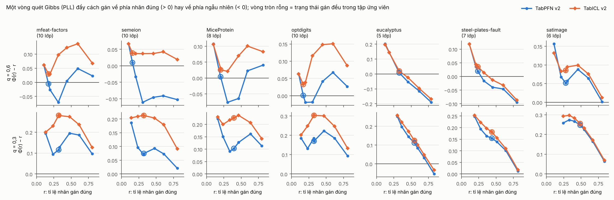

# S2X — ánh xạ phản ứng của vòng quét Gibbs (thăm dò, dataset cũ của NC1; 02/11/2026)

S2_PLAN §5.1. Lượt S2X, 01/11:
- 588/588 dòng ok, code khớp commit đóng băng;
- 7 dataset đa lớp của NC1, PLL q = 0,3 và 0,6, 3 seed, TabPFN v2 và TabICL v2.

Script: `G4/code/s2x_response_map.py`. Tóm tắt và hình: `S2/analysis/s2x_response_map_report.py` → `S2/results/s2x_summary.csv`, `S2/figures/s2x_response_map.png`.

**Đây là phân tích cơ chế trên dữ liệu đã dùng, không phải kiểm định.** Nhãn thật chỉ dùng để gieo cách gán và để đo.

## Đo cái gì
1. Gieo một cách gán nhãn có tỉ lệ đúng r. Mỗi nhãn sai được chọn đều trong số các nhãn sai của tập ứng viên.
2. Chạy **một vòng quét** đúng như bước Gibbs: K = 10 khối, ngữ cảnh là các khối còn lại, TFM đúng cấu hình của chuỗi.
3. Đo Φ(r) là tỉ lệ đúng sau vòng quét đó, rồi tính **gain = Φ(r) − r**.
   - Gain > 0: vòng quét đẩy về phía nhãn đúng.
   - Gain < 0: vòng quét kéo về phía ngẫu nhiên.
   - Chỗ gain = 0 là điểm bất động. Điểm bất động ổn định nếu gain đổi từ dương sang âm khi r tăng.

## Kết quả

**Gain tại trạng thái gán đều trong tập ứng viên**, tức điểm xuất phát gần như không mang thông tin (r ≈ 1/|S|):

| Dataset (số lớp) | q = 0,6: TabPFN | q = 0,6: TabICL | q = 0,3: TabPFN | q = 0,3: TabICL |
|---|---|---|---|---|
| mfeat-factors (10) | **−0,005** | +0,030 | +0,116 | +0,281 |
| semeion (10) | **+0,010** | +0,039 | +0,075 | +0,213 |
| MiceProtein (8) | **+0,004** | +0,026 | +0,103 | +0,226 |
| optdigits (10) | **+0,001** | +0,033 | +0,170 | +0,303 |
| eucalyptus (5) | +0,007 | +0,019 | +0,111 | +0,124 |
| steel-plates-fault (7) | +0,019 | +0,036 | +0,154 | +0,181 |
| satimage (6) | +0,052 | +0,086 | +0,248 | +0,255 |

**Gain nhỏ nhất trong vùng r ≈ 0,2–0,45, ở q = 0,6:**

| | mfeat | semeion | MiceProtein | optdigits |
|---|---|---|---|---|
| TabPFN | **−0,071** | **−0,111** | **−0,077** | **−0,019** |
| TabICL | +0,030 | +0,037 | +0,021 | +0,038 |

## Đọc kết quả

**1. Giải thích được đúng kiểu sụp của NC1.**
- Ở q = 0,6 trên bốn dataset ≥ 8 lớp, với TabPFN, gain tại điểm xuất phát gần như bằng 0. Trong vùng 0,2–0,45, gain **âm**, tức vòng quét kéo cách gán về phía ngẫu nhiên. Trạng thái gần ngẫu nhiên vì vậy là một **điểm bất động hút**, và chuỗi kẹt ở đó.
- Với TabICL, gain **dương ở mọi r** trên bốn dataset này. Chỉ còn một điểm hút ở r cao, nên chuỗi thoát.
- Ở q = 0,3, gain dương rõ với cả hai TFM. Không sụp, khớp NC1.

**2. TabPFN có hai lưu vực (song ổn).**
- Trên mfeat, MiceProtein và optdigits, gain của TabPFN âm ở r trung bình nhưng **dương trở lại ở r ≳ 0,45–0,6**. Như vậy có một điểm bất động không ổn định nằm giữa hai điểm hút.
- Điều này khớp với hai lưu vực đã thấy trên optdigits ở NC1 (2/3 seed thoát). Trên optdigits, vùng âm của gain nông nhất (−0,019), nên chuỗi dễ vượt qua nhất.
- semeion không có lưu vực trên: gain vẫn âm cả ở r = 0,8. Khớp việc semeion sụp ở mọi seed.
- Mô hình tuyến tính (G8) không tạo được hai lưu vực. Số liệu này xác nhận phản ứng của TabPFN với nhãn ngữ cảnh là **phi tuyến**, đúng giả thuyết ở S2_PLAN §5.1.

**3. Hệ quả cho lý thuyết** (Mệnh đề dự kiến, nối với Định lý 2):
- Điều kiện thoát được phát biểu qua dấu của gain trên đoạn [r₀, r*], với r₀ là điểm xuất phát và r* là vùng nhãn tốt.
- TFM nào cho gain dương trên cả đoạn này thì chuỗi Gibbs thoát từ bất kỳ khởi động nào.
- Cách đo ở đây là một **phép chẩn đoán trực tiếp**, nhưng cần nhãn thật. Muốn dùng được trong thực tế cần một bản thay thế không cần nhãn. Đây là việc kế tiếp.

## Giới hạn
- Nhãn sai được gieo **đều**. Lỗi của chuỗi thật có cấu trúc (thường gần biên lớp), nên vị trí điểm bất động khác chuỗi thật về định lượng. Ví dụ eucalyptus: điểm bất động của ánh xạ gieo ở khoảng 0,35, còn chuỗi thật đạt khoảng 0,65 nhãn đúng.
- Kết luận định tính (dấu của gain ở vùng thấp, có hay không lưu vực trên) mới là phần đáng tin.
- Đây là bản "Jacobi": mọi khối dùng cùng cách gán, khác bước tuần tự của Gibbs.
