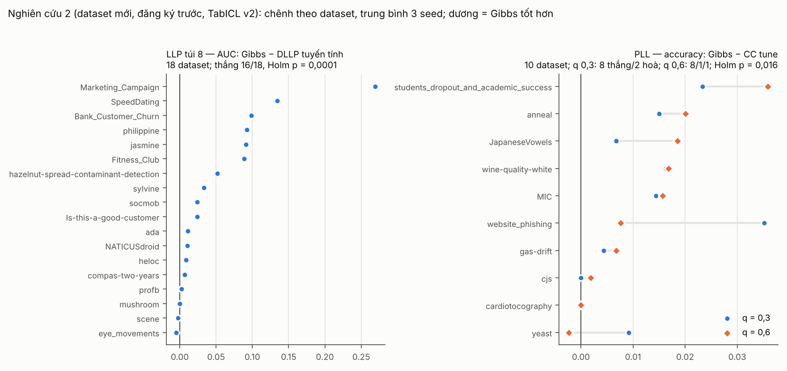

# Nghiên cứu 2: kết quả xác nhận (bản cuối, 03/11/2026)

**Kết luận: S2 đạt "thành công mạnh" theo S2_PLAN §1.** Cả ba giả thuyết đều đạt: H2-LLP′, H4-PLL′ và H3′. Độ nhạy S1 không đổi kết luận nào.

- **Kế hoạch:** S2_PLAN đóng băng ở commit `aaee9fd`, 01/11/2026 15:19 UTC, trước khi tải dữ liệu đánh giá. Danh sách cuối nằm ở `s2_final.csv`, áp §3.4.
- **Phân tích:** `S2/analysis/s2_confirmatory.py`, áp đúng §1 và §4. Script viết trước khi có số, trừ một sửa lỗi làm tròn ghi ở Mục 6.
- **Hình:** `S2/analysis/s2_figures.py`.
- **Kết quả:** `S2/results/`, gồm json, bảng theo dataset, ô H3 và so sánh với từng baseline.
- **Dữ liệu:**
  - LLP túi 8: 18 dataset × 3 seed.
  - PLL q = 0,3 và 0,6: 10 dataset × 3 seed.
  - Lượt S2T, S2C1, S2C2 chạy bằng code đóng băng. Lượt S2G (gas-drift) chạy ở commit `40456af`.
  - Mọi ô của phép thử chính đủ 3 seed. Chỉ thiếu 5 ô của PRODEN mặc định trên gas-drift; chạy lại ở lượt S2R vẫn lỗi y hệt (Mục 5).

## 1. H2-LLP′ (LLP túi 8, AUC; TFM là TabICL v2): **ĐẠT**

| So sánh | Chênh trung bình [CI 95%] | Thắng/hoà/thua | p (Holm) |
|---|---|---|---|
| Gibbs − DLLP tuyến tính (đối thủ chính) | **+0,052** [+0,024; +0,086] | 16/0/2 | **0,0001** |
| Gibbs − TFM ngây thơ | **+0,116** [+0,085; +0,150] | 18/0/0 | **0,00002** |
| Gibbs − baseline mạnh nhất trên tập S2 (DLLP tune) | +0,041 [+0,018; +0,072] | **16/18 = 89%** (cần ≥ 70%) | p chưa hiệu chỉnh 0,0004 |

- **AUC trung bình:**

  | Phương pháp | AUC |
  |---|---|
  | Gibbs | 0,840 |
  | hard-EM | 0,827 |
  | DLLP tune | 0,799 |
  | DLLP tuyến tính | 0,788 |
  | TFM ngây thơ | 0,724 |
  | oracle | 0,879 |

- **Thua DLLP tuyến tính ở 2 dataset, đều rất sát:** eye_movements (−0,005) và scene (−0,002).
- **Thắng đậm:**
  - Marketing_Campaign: +0,27
  - SpeedDating: +0,13
  - Bank_Customer_Churn, philippine, jasmine, Fitness_Club: +0,09 tới +0,10
- **S1** (bỏ SpeedDating và eye_movements, còn 16 dataset): **vẫn đạt.**
  - So với DLLP tuyến tính: +0,051, 15/0/1, Holm 0,0001.
  - So với TFM ngây thơ: +0,124, 16/0/0.
  - Trước baseline mạnh nhất của tập con (LLP-VAT tune): thắng 14/16 = 88%.

Bảng theo dataset: `results/s2_table_llp8.csv`.

## 2. H4-PLL′ (PLL, accuracy): **ĐẠT**

| Mức | So sánh | Chênh trung bình [CI 95%] | Thắng/hoà/thua | p (Holm trên 4) |
|---|---|---|---|---|
| q = 0,3 | Gibbs − CC tune (đối thủ chính) | **+0,0125** [+0,0065; +0,0192] | 8/2/0 | **0,016** |
| q = 0,3 | Gibbs − TFM ngây thơ | **+0,022** [+0,012; +0,033] | 10/0/0 | **0,008** |
| q = 0,6 | Gibbs − CC tune | **+0,0121** [+0,0056; +0,0193] | 8/1/1 | **0,016** |
| q = 0,6 | Gibbs − TFM ngây thơ | **+0,205** [+0,094; +0,337] | 10/0/0 | **0,008** |

**Quy tắc 60%, đọc theo từng mức** (cách đọc ghi rõ trong S2_PLAN §1). Baseline mạnh nhất là baseline có accuracy trung bình cao nhất ở mức đó:

| Mức | Baseline mạnh nhất | Gibbs ≥ baseline ở | Cần |
|---|---|---|---|
| q = 0,3 | CC tune | **10/10 = 100%** | ≥ 60% |
| q = 0,6 | RC tune | **9/10 = 90%**; chỉ thua ở yeast, −0,002 | ≥ 60% |

**Accuracy trung bình:**

| Phương pháp | q = 0,3 | q = 0,6 |
|---|---|---|
| Gibbs | **0,862** | **0,851** |
| hard-EM | 0,862 | 0,803 |
| CC tune | 0,850 | 0,839 |
| RC tune | — | 0,839 |
| TFM ngây thơ | 0,840 | 0,647 |
| oracle (nhãn thật) | 0,870 | 0,870 |

- **Dataset Gibbs không thắng CC tune:**
  - cardiotocography: hoà ở cả hai mức, tất cả đều 1,000.
  - cjs, q = 0,3: hoà, 0,9969 = 0,9969.
  - yeast, q = 0,6: thua 0,0023.
- **Thắng nhiều nhất:** students_dropout, +0,023 và +0,036; website_phishing ở q = 0,3, +0,035.
- **Bốn dataset ≥ 8 lớp** (yeast, JapaneseVowels, cardiotocography, MIC): Gibbs **không sụp** ở q = 0,6. Đây là vùng mà TabPFN sụp ở NC1.
  - Accuracy của Gibbs: 0,561 / 0,989 / 1,000 / 0,886.
  - Accuracy của CC tune: 0,564 / 0,970 / 1,000 / 0,870.
  - Hard-EM cùng TFM, cùng điểm khởi động thì kẹt ở vài dataset, q = 0,6: cjs 0,830 (Gibbs 0,993), cardiotocography 0,886 (1,000), yeast 0,456 (0,561).
- **S1, đa lớp** (bỏ JapaneseVowels, cjs, gas-drift, còn 7 dataset): **không khác kết luận** theo quy tắc thầy duyệt 01/11.
  - q = 0,3: +0,016, 6/1/0, thắng 86%.
  - q = 0,6: +0,013, 5/1/1, thắng 71%.
  - Không đổi dấu, thắng ≥ 60%.
  - p Holm của S1 bằng 0,0625 ở cả 4 phép, đúng như dự kiến với n = 7. Lý do đặt quy tắc S1 theo chiều và độ rộng là vì vậy (S2_DATASETS §4.2).

Bảng theo dataset: `results/s2_table_pll_0.3.csv`, `results/s2_table_pll_0.6.csv`.

## 3. H3′ (Gibbs so với hard-EM, log loss): **ĐẠT**

| Chỉ số | Kết quả | Tiêu chí |
|---|---|---|
| Số ô | 38 (LLP 18; PLL 20) | |
| Gibbs tốt hơn hard-EM | **78,9%** (LLP 14/18 = 77,8%; PLL 16/20 = 80%) | ≥ 70% |
| Bayesian signed-rank, ROPE ±0,005 | P(Gibbs tốt hơn) = 1,00; P(ROPE) = 0,00 | P(ROPE) ≤ 0,9 |
| Spearman (mức yếu, chênh), trên ô PLL | **ρ = 0,66** (p = 0,0016) | ρ > 0 |

- ρ tính trên ô PLL. Lý do: LLP chỉ có một mức nên không mang thông tin về thứ tự. Cách tính này ghi trong docstring của script trước khi chạy.
- **Các ô hard-EM không thua:**
  - LLP: scene, sylvine, NATICUSdroid, mushroom.
  - PLL q = 0,3: JapaneseVowels, gas-drift, cjs; cardiotocography hoà.
  - Ở q = 0,6, Gibbs tốt hơn ở mọi ô PLL. Điều này khớp với ρ dương: nhãn càng yếu, lợi thế của việc lấy mẫu so với gán cứng càng lớn.

Ô: `results/s2_h3_cells.csv`.

## 4. Phân tích phụ: so với từng baseline (Holm trên mọi cặp của bối cảnh)

- **LLP:** Gibbs tốt hơn **cả 10 baseline** có ý nghĩa sau Holm. Chênh +0,041 tới +0,116; Holm ≤ 0,0006.
- **PLL:** chênh với **cả 16 cặp** baseline × mức đều dương; Gibbs thắng ≥ 8/10 ở mọi cặp.
  - 7/16 cặp có ý nghĩa sau Holm trên 16 phép. Ở q = 0,3: PRODEN, GLWS, RC, CC bản mặc định và GLWS tune. Ở q = 0,6: PRODEN và GLWS bản mặc định.
  - 9 cặp còn lại có Holm 0,070. Với n = 10 và Holm trên 16 phép, có 1–2 dataset thua hoặc hoà là không qua được ngưỡng.
  - Đây là phân tích phụ, không thuộc tiêu chí đạt.

Bảng: `results/s2_per_baseline.csv`.

## 5. Ô thiếu: PRODEN mặc định trên gas-drift

- **Lỗi:** 5/6 ô (q = 0,3 cả 3 seed; q = 0,6 seed 1, 2) báo `ValueError('proden_def: xác suất không hữu hạn')`: mạng phân kỳ với siêu tham số mặc định. Các ô lỗi dừng sau vài giây.
- **Ô chạy được** (q = 0,6, seed 0) cho accuracy 0,943. PRODEN tune thì chạy đủ, nhưng thấp: 0,848 và 0,811.
- **Không ảnh hưởng phép thử chính:** PRODEN mặc định không phải đối thủ chính và không phải baseline mạnh nhất ở mức nào. Nó chỉ vào phân tích phụ; ở q = 0,3 tính trên 9 dataset.
- **Theo G7_PLAN §2:** ô lỗi được chạy lại một lần ở lượt **S2R** (03/11). Cả 5 ô lỗi lặp lại y hệt; ô chạy được cho đúng 0,9430 như lần đầu. Lỗi là tất định, nên 5 ô ghi **"thiếu, có lý do"** và báo cáo trong bài. Phân tích đọc cả `raw/S2R/`; mọi số không đổi.

## 6. Sửa lỗi làm tròn trong script phân tích (03/11/2026, sau khi đã thấy số)

- **Phát hiện:** khi đọc bảng, em thấy ô cjs, PLL q = 0,3 bị đếm là Gibbs thua CC tune. Thực ra hai phương pháp có cùng accuracy ở cả 3 seed. Trung bình cộng theo thứ tự khác nhau nên lệch nhau −2,2·10⁻¹⁶.
- **Cách sửa:** `s2_confirmatory.py` làm tròn trung bình theo seed tới 10 chữ số thập phân trước khi so. Cách này chỉ đổi những chênh nhỏ hơn 10⁻¹⁰.
- **Trước khi sửa:**
  - q = 0,3 so với CC tune: 8/1/1 (sau khi sửa 8/2/0). p không đổi, vì Wilcoxon của 9 chênh với hạng âm nhỏ nhất và của 8 chênh toàn dương cho cùng p = 0,0078.
  - Quy tắc 60% ở q = 0,3: 9/10 (sau khi sửa 10/10).
- **Mọi kết luận không đổi.**
- **NC1:** đã kiểm các bảng G8. Không có chênh nào khác 0 mà nhỏ hơn 10⁻⁹, nên số liệu NC1 không bị ảnh hưởng.

## 7. Chi phí (TabICL v2, Kaggle T4)
- 114 chuỗi Gibbs; n_train tới 7.000.
- Thời gian một chuỗi: trung vị 41 giây; LLP trung vị 80 giây, lớn nhất 5,3 phút; PLL trung vị 30 giây, lớn nhất 2,6 phút.
- Đỉnh bộ nhớ GPU 3,7 GiB (3.760 MiB) trên 15 GiB. Không huấn luyện lại.

## 8. Kiểm lại độc lập
Em viết lại phép thử chính bằng một script riêng (`analysis/s2_verify_independent.py`), không dùng hàm nào của dự án: đọc thẳng `raw/`, tự tính Wilcoxon và Holm. Kết quả trùng khớp với `s2_confirmatory.py`:
- H2′: chênh, thắng/hoà/thua, p Holm, baseline mạnh nhất, tỉ lệ thắng.
- H4′: cả 4 p Holm (0,0156 / 0,0078 / 0,0156 / 0,0078) và quy tắc 60% (100%, 90%).
- Đủ 3 seed ở mọi ô của Gibbs, đối thủ chính và TFM ngây thơ.

## 9. Đặt cạnh nghiên cứu 1

| | NC1, TabPFN v2 (xác nhận) | NC1, TabICL v2 (thăm dò, chọn sau khi xem số) | **S2, TabICL v2 (xác nhận, dữ liệu mới)** |
|---|---|---|---|
| LLP túi 8, so với DLLP tuyến tính | +0,024; 8/2; Holm 0,23: **không đạt** | +0,058; 10/0; Holm 0,004 | **+0,052; 16/2; Holm 0,0001: đạt** |
| PLL q = 0,3, so với CC tune | +0,022; 10/4; Holm 0,084 | đạt (12/14) | **+0,0125; 8/2/0; Holm 0,016: đạt** |
| PLL q = 0,6, so với CC tune | −0,132; sụp ở ≥ 8 lớp: **không đạt** | đạt (12/14) | **+0,0121; 8/1/1; Holm 0,016: đạt** |
| H3 (Gibbs so với hard-EM) | đạt (86,7% ô) | — | **đạt (78,9% ô; ρ 0,66)** |

**Diễn giải:**
- Phát hiện thăm dò của NC1 được xác nhận: In-Context Gibbs với TabICL v2 vượt baseline chuyên biệt mạnh nhất ở LLP túi 8 và ở PLL.
  - Xác nhận trên 28 dataset nằm ngoài tập phát triển và tập đánh giá của NC1, với kế hoạch đăng ký trước.
  - Riêng yeast từng dùng ở G6, chỉ để tái hiện baseline, không chạy Gibbs.
- Khẳng định đúng là **"In-Context Gibbs với một TFM bền với nhãn ngữ cảnh nhiễu"**, không phải "với mọi TFM". Thất bại của TabPFN ở NC1 vẫn phải báo cáo đầy đủ, cùng cơ chế giải thích ([S2X_REPORT](S2X_REPORT.md)).
- **Độ lớn hiệu ứng:**
  - LLP: lợi thế lớn (+5 điểm AUC so với DLLP tuyến tính), khoảng cách tới oracle còn 0,04.
  - PLL: lợi thế khiêm tốn (+1,2 điểm accuracy so với CC tune), nhưng nhất quán, và Gibbs chỉ cách oracle 0,8–1,9 điểm. Bài nên viết đúng mức này.
