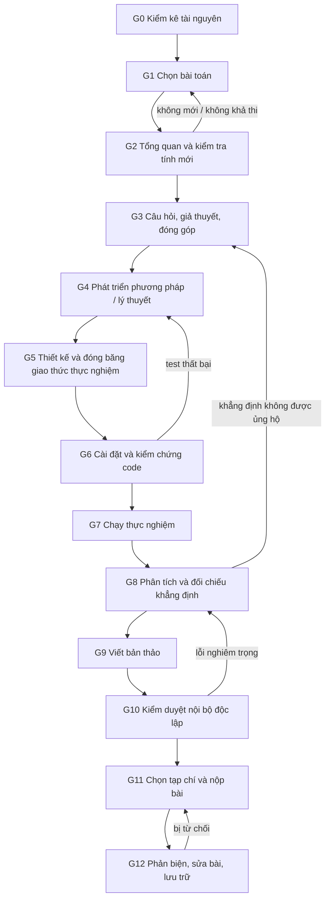

# Sổ tay Nghiên cứu Khoa học Máy tính & Khoa học Dữ liệu

Bộ quy tắc và quy trình nghiên cứu hàn lâm dùng cho mọi đề tài thuộc Khoa học Máy tính (KHMT) và Khoa học Dữ liệu (KHDL): lý thuyết, thuật toán, phương pháp học máy, khai phá dữ liệu, ứng dụng học máy cho một lĩnh vực, hệ thống, bộ dữ liệu/benchmark và tổng quan tài liệu.

Mọi quy tắc ở đây đều dựa trên một chuẩn đã công bố: checklist của NeurIPS, REFORMS (*Science Advances* 2024), ACM Artifact Review and Badging, ACM SIGSOFT Empirical Standards, hướng dẫn thống kê của *JMLR*, hướng dẫn tổng quan tài liệu của Kitchenham và PRISMA 2020, cùng chính sách liêm chính và chính sách AI của các nhà xuất bản lớn. Nguồn đầy đủ ở [REFERENCES.md](REFERENCES.md).

> Phiên bản 1.0 · 24/10/2026. Khi chuẩn bên ngoài thay đổi (checklist hội nghị, chính sách nhà xuất bản, luật dữ liệu), cập nhật file tương ứng và ghi vào mục *Lịch sử thay đổi* ở cuối file này.

---

## 1. Mười hai quy tắc vàng

| # | Quy tắc | Căn cứ |
|---|---|---|
| 1 | **Mỗi khẳng định phải có bằng chứng tương xứng.** Không khẳng định điều thực nghiệm không đo. Dùng ma trận khẳng định–bằng chứng (claim–evidence matrix) từ đầu dự án. | NeurIPS Checklist Q1–Q2; Lipton & Steinhardt 2019 |
| 2 | **Viết câu hỏi, giả thuyết, kế hoạch phân tích và kết quả dự đoán trước khi chạy thực nghiệm chính**, rồi đóng băng có ngày. Mọi thay đổi sau đó được ghi lại và gọi là phân tích *khám phá* (exploratory). | REFORMS module 1; Kerr 1998 (HARKing) |
| 3 | **Tập test chỉ chạm một lần.** Mọi bước được fit (chuẩn hoá, impute, chọn feature, tune) chỉ fit trên dữ liệu train của từng fold. | Kapoor & Narayanan 2023; Cawley & Talbot 2010 |
| 4 | **Baseline phải mạnh và công bằng**: dùng code chính thức, tái hiện được số liệu đã công bố trước khi so, được tune với cùng ngân sách như phương pháp đề xuất. | Melis et al. 2018; Musgrave et al. 2020; Arp et al. 2022 |
| 5 | **Báo cáo độ biến thiên và kiểm định thống kê** trên nhiều split và seed. Không chọn lọc seed, dataset hay metric có lợi. | NeurIPS Q7; Bouthillier et al. 2021; Demšar 2006 |
| 6 | **Mỗi thành phần đóng góp phải có ablation** chứng minh nó tạo ra cải thiện. | Lipton & Steinhardt 2019 |
| 7 | **Báo cáo trung thực giới hạn, kết quả âm và mối đe doạ tính hợp lệ.** | NeurIPS Q2; Wohlin et al. 2012 |
| 8 | **Tái lập được từ một bản clone sạch** bằng các lệnh ghi trong README: code, môi trường, seed, phiên bản dữ liệu. | ACM Badging v1.1; Pineau et al. 2021 |
| 9 | **Mọi trích dẫn phải được mở ra và đối chiếu** (DOI, tiêu đề, năm, nội dung được dẫn). Bắt buộc với mọi tài liệu do công cụ AI gợi ý. | Chính sách AI của Elsevier, Springer Nature, ACM, IEEE |
| 10 | **Mỗi cổng (gate) có một người hoặc agent kiểm duyệt độc lập**, không tham gia tạo ra sản phẩm của cổng đó. | ACM Artifact Evaluation; thực hành phản biện nội bộ |
| 11 | **Liêm chính:** tiêu chí tác giả rõ ràng, khai báo dùng AI, không đạo văn hay tự đạo văn, không chia nhỏ một kết quả thành nhiều bài, không nộp song song. | Singapore Statement 2010; COPE; ICMJE |
| 12 | **Dữ liệu cá nhân tuân thủ pháp luật và giấy phép**: Luật Bảo vệ dữ liệu cá nhân số 91/2025/QH15 (hiệu lực 01/01/2026), giấy phép của từng bộ dữ liệu. | [01_NGUYEN_TAC_VA_LIEM_CHINH.md](01_NGUYEN_TAC_VA_LIEM_CHINH.md) |

---

## 2. Quy trình 13 cổng

Mỗi dự án đi qua 13 cổng (G0–G12). Ở mỗi cổng có ba quyết định: **Qua**, **Sửa** (quay lại bước trước), hoặc **Dừng** (kill: bỏ đề tài khi tiêu chí dừng bị chạm). Chi tiết ở [02_QUY_TRINH_CONG_KIEM_DUYET.md](02_QUY_TRINH_CONG_KIEM_DUYET.md).



Nguyên tắc khi quay lại: khi khẳng định không được dữ liệu ủng hộ, **sửa khẳng định, không sửa dữ liệu hay giao thức** để khẳng định đúng.

---

## 3. Chọn bộ quy tắc theo loại hình nghiên cứu

| Loại hình | Ví dụ | File chính | Chuẩn bên ngoài |
|---|---|---|---|
| Lý thuyết | chặn (bound), định lý hội tụ, độ phức tạp | [07](07_LY_THUYET_VA_CHUNG_MINH.md) | NeurIPS Q3 |
| Thuật toán / khai phá dữ liệu | thuật toán khai phá itemset, cấu trúc dữ liệu, heuristic | [05](05_LOAI_HINH_NGHIEN_CUU.md), [06](06_THIET_KE_THUC_NGHIEM.md) | Johnson 2002; Bartz-Beielstein et al. 2020 |
| Phương pháp học máy / deep learning | mô hình, hàm mất mát, kiến trúc mới | [06](06_THIET_KE_THUC_NGHIEM.md) | NeurIPS Checklist; Demšar 2006 |
| Học máy ứng dụng / KHDL | dự báo bỏ học, rủi ro tín dụng | [06](06_THIET_KE_THUC_NGHIEM.md) | REFORMS; Kapoor & Narayanan 2023 |
| Hệ thống / artifact | công cụ, hệ thống, pipeline | [05](05_LOAI_HINH_NGHIEN_CUU.md), [08](08_TAI_LAP_VA_MA_NGUON.md) | Hevner et al. 2004; Peffers et al. 2007; ACM Badging |
| Bộ dữ liệu / benchmark | dataset mới, bộ đánh giá | [05](05_LOAI_HINH_NGHIEN_CUU.md), [templates/DATASET_CARD.md](templates/DATASET_CARD.md) | Gebru et al. 2021; NeurIPS Q12–13 |
| Tổng quan có hệ thống | SLR, mapping study | [04](04_TONG_QUAN_TAI_LIEU.md) | Kitchenham & Charters 2007; PRISMA 2020; Wohlin 2014 |

Một bài thường thuộc hai loại (ví dụ thuật toán + lý thuyết): áp dụng đồng thời chuẩn của cả hai.

---

## 4. Cấu trúc bộ tài liệu

```
research-handbook/
├── README.md                          ← file này
├── 01_NGUYEN_TAC_VA_LIEM_CHINH.md     liêm chính, tác giả, AI, dữ liệu cá nhân
├── 02_QUY_TRINH_CONG_KIEM_DUYET.md    13 cổng: đầu vào, việc làm, sản phẩm, tiêu chí qua cổng
├── 03_CHON_DE_TAI.md                  tiêu chí bắt buộc, Heilmeier, chấm điểm, tiêu chí dừng
├── 04_TONG_QUAN_TAI_LIEU.md           tìm kiếm có nhật ký, snowballing, kiểm tra tính mới
├── 05_LOAI_HINH_NGHIEN_CUU.md         chuẩn riêng cho từng loại hình nghiên cứu
├── 06_THIET_KE_THUC_NGHIEM.md         dữ liệu, baseline, split, rò rỉ, thống kê, ablation
├── 07_LY_THUYET_VA_CHUNG_MINH.md      định nghĩa, giả định, chứng minh, kiểm chứng
├── 08_TAI_LAP_VA_MA_NGUON.md          cấu trúc repo, môi trường, seed, log, lưu trữ
├── 09_VIET_BAI_VA_NOP_BAI.md          cấu trúc bài, chọn tạp chí, nộp, trả lời phản biện
├── 10_CHECKLIST_TRUOC_KHI_NOP.md      checklist tổng hợp trước khi nộp
├── REFERENCES.md                      toàn bộ nguồn, có liên kết
└── templates/
    ├── RESOURCE_INVENTORY.md          G0
    ├── TOPIC_CARD.md                  G1
    ├── NOVELTY_SEARCH_LOG.md          G2
    ├── RESEARCH_PLAN.md               G3 (đăng ký trước nội bộ)
    ├── EXPERIMENT_PROTOCOL.md         G5 (đóng băng)
    ├── EXPERIMENT_LOG.md              G7
    ├── CLAIM_EVIDENCE_MATRIX.md       G3 → G10
    ├── GATE_REVIEW.md                 mọi cổng
    ├── DATASET_CARD.md                G5
    └── RESPONSE_TO_REVIEWERS.md       G12
```

## 5. Cách dùng cho một dự án mới

1. Tạo thư mục dự án, sao chép `templates/` vào `docs/` của dự án.
2. Điền `RESOURCE_INVENTORY.md` (G0) trước khi nghĩ đến đề tài cụ thể.
3. Đi lần lượt các cổng. Mỗi cổng kết thúc bằng một file `GATE_REVIEW.md` có chữ ký người kiểm duyệt độc lập và quyết định Qua/Sửa/Dừng.
4. Commit mọi template đã điền vào git. Ngày commit là bằng chứng "viết trước khi chạy" cho quy tắc 2.

## Lịch sử thay đổi

| Phiên bản | Ngày | Thay đổi |
|---|---|---|
| 1.0 | 24/10/2026 | Bản đầu tiên |
